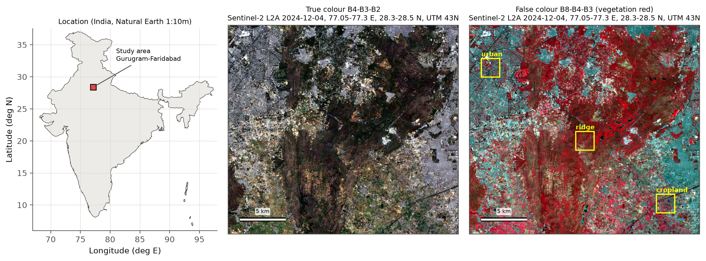
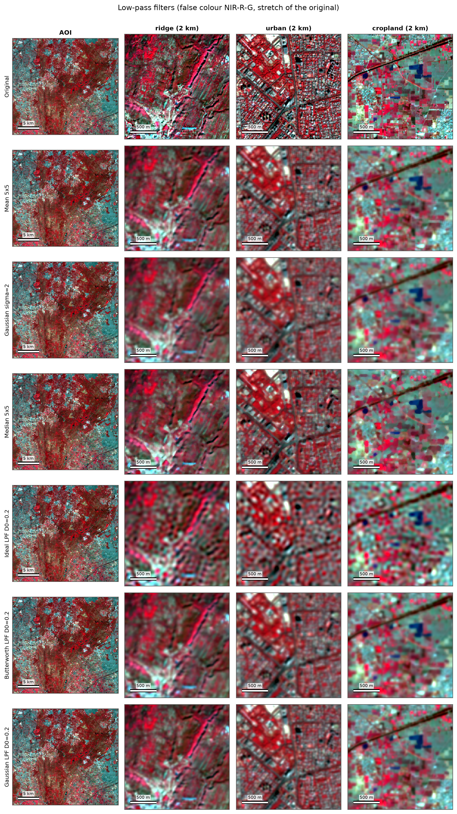
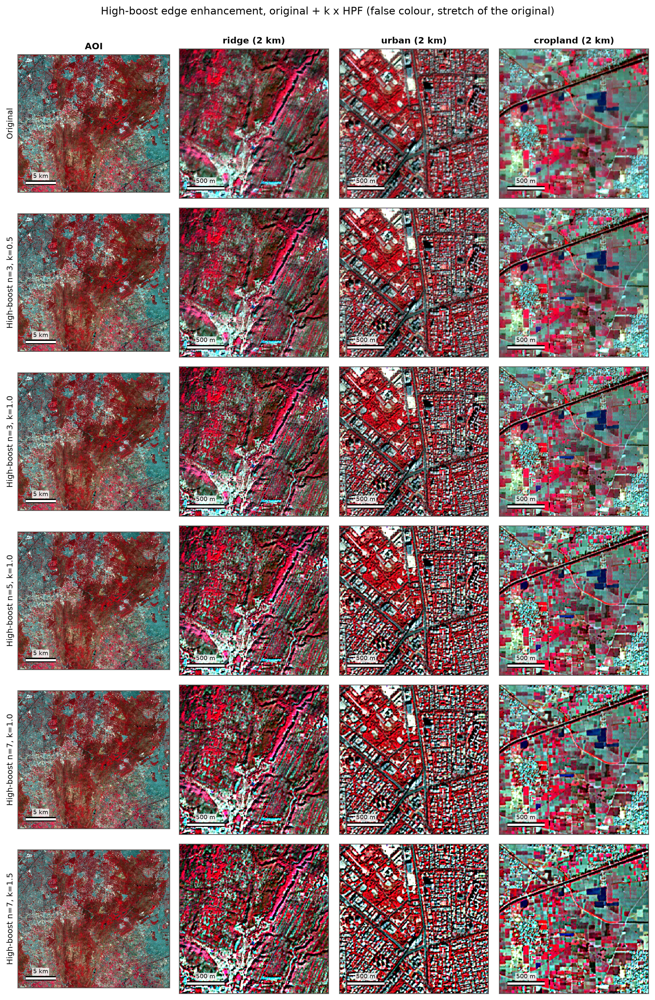
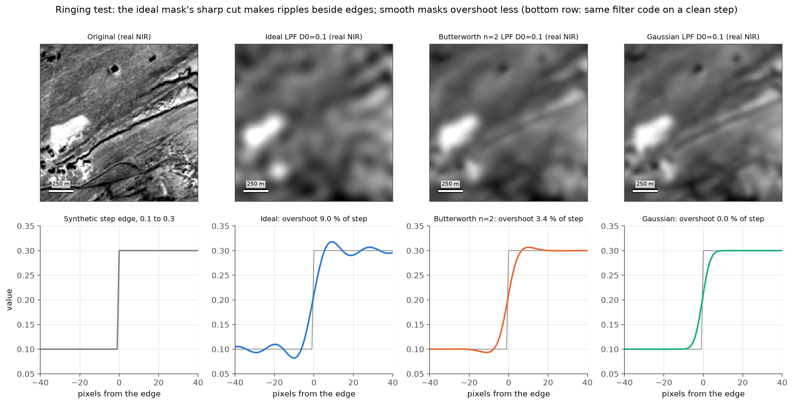
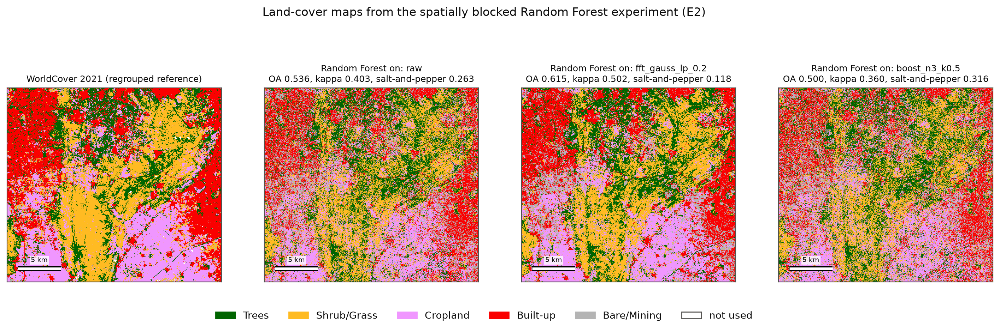

# Low-pass vs high-pass filtering of Sentinel-2 imagery

**Topic 5:** implement low-pass and high-pass filtering on remote sensing data and decide which technique suits which remote sensing application.

The study area is the Aravalli ridge between Gurugram and Faridabad (Haryana, India). One Sentinel-2 L2A scene contains folded quartzite ridges, a dense street grid, small crop parcels and quarries, so both filter families can be tested on the same image. Every filter is written in NumPy, in the spatial domain (convolution) and in the frequency domain (FFT masks). Each is then tested on five measurable questions: noise removal, land-cover classification, edge detail, spectral fidelity and run time.



<!-- RESULTS:START -->
## Results at a glance

Scene: **S2B_MSIL2A_20241204T053119_N0511_R105_T43RGM_20241204T074212** (2024-12-04), chosen from 11 candidates; 0.08 % of AOI pixels flagged as cloud, shadow or no data, mean AOT 0.164.

| Application | Best filter | Evidence | Runner-up |
|---|---|---|---|
| Noise removal (Gaussian noise) | `gauss_s1` | PSNR (dB) 35.56 (no filter 33.98) | `box_3` |
| Noise removal (salt-and-pepper noise) | `median_3` | PSNR (dB) 36.49 (no filter 21.01) | `median_5` |
| Land-cover classification | `fft_gauss_lp_0.2` | Cohen's kappa 0.502 (no filter 0.403) | `gauss_s2` |
| Lineament / structural mapping (Aravalli ridges) | `prewitt` | orientation coherence on the ridge 0.536 (no filter 0.510) | `sobel` |
| Urban boundary delineation | `boost_n3_k0.5` | built-up boundary F1 0.545 (no filter 0.543) | `boost_n3_k1.0` |
| Visual interpretation | `boost_n3_k1.0` | NIR average gradient 0.042 (no filter 0.025) | `boost_n7_k0.5` |

Smoothing raised Random Forest kappa from 0.403 to 0.502 and cut map speckle from 0.263 to 0.118. High-boost lowered kappa, but it gave the sharpest image and the best agreement between Canny edges and mapped boundaries. So low-pass filtering is the better choice when per-pixel values feed a calculation, and high-pass filtering when the analyst cares about edges and structure.

On salt-and-pepper noise a 3 x 3 median reached 36.49 dB, 5.42 dB ahead of the best linear filter. On a clean step edge the ideal frequency-domain LPF overshoots by 9.0 %, Butterworth by 3.4 % and Gaussian by 0.0 %. Every frequency-domain filter took 1.36-1.48 s on a full band whatever its cutoff, while spatial convolution was faster only for kernels below about 13 pixels.

All values come from `results/tables/`. Report: [`report/Group1_EES403_Report.pdf`](report/Group1_EES403_Report.pdf); slides: [`presentation/Group1_EES403_Slides.pdf`](presentation/Group1_EES403_Slides.pdf).

| | |
|---|---|
|  |  |
|  |  |
<!-- RESULTS:END -->

---

## Contents

1. [Quick start](#quick-start)
2. [Commands](#commands)
3. [Repository layout](#repository-layout)
4. [Data](#data)
5. [Methods in brief](#methods-in-brief)
6. [Outputs](#outputs)
7. [Reproducibility](#reproducibility)
8. [Executable](#executable)
9. [Deliverables](#deliverables)
10. [Limitations](#limitations)
11. [References](#references)

## Quick start

Python 3.11 or 3.12.

```bash
python -m venv .venv
# Linux / macOS
source .venv/bin/activate
# Windows (PowerShell)
.venv\Scripts\Activate.ps1

pip install -r requirements.txt
pip install -e .

python -m rsfilter demo          # offline, uses data/sample only, about a minute
pytest -q                        # filters checked against scipy.ndimage
```

To download the scene yourself you need either a Google Earth Engine project (put `EE_PROJECT=...` in `.env`, see `.env.example`, then run `earthengine authenticate` once) or nothing at all: without Earth Engine the program falls back to Microsoft Planetary Computer and then to Element84 Earth Search, which need no account.

```bash
python scripts/run_all.py        # fetch (if needed), test, experiments, figures, report, slides
```

## Commands

`python -m rsfilter <command>` (or `rsfilter <command>` after `pip install -e .`, or `dist/rsfilter <command>` for the executable).

| Command | What it does |
|---|---|
| `fetch [--backend auto\|gee\|pc\|earthsearch]` | Searches Nov 2024 - Feb 2025 for Sentinel-2 L2A scenes over the AOI, scores cloud, shadow, no data and haze **inside the AOI**, downloads the best scene and ESA WorldCover onto a 10 m UTM 43N grid, writes `scene_metadata.json`, the 512 x 512 sample crop and quick-looks |
| `filter --input in.tif --filter NAME [--params k=v ...] --out out.tif` | Applies one filter to every band and keeps the georeferencing. `NAME` is a base filter (`mean`, `gaussian`, `median`, `highpass`, `laplacian`, `sobel`, `prewitt`, `highboost`, `fft`) or a filter-bank name such as `gauss_s2`, `boost_n3_k1.0`, `fft_butter_lp_0.2` |
| `evaluate [--input] [--labels] [--out] [--quick]` | Runs experiments E1-E5 and the decision matrix; writes CSVs to `results/tables/` and class maps to `results/maps/` |
| `figures` | Regenerates every figure in `results/figures/` |
| `demo` | The full pipeline on `data/sample/` only, offline, about a minute, results in `results/demo/`. E2 uses a reduced filter set, and the lineament row is left out because the ridge window lies outside the 512 x 512 crop |

Examples:

```bash
python -m rsfilter filter --input data/sample/reflectance.tif --filter gaussian --params sigma=2 --out gauss2.tif
python -m rsfilter filter --input data/sample/reflectance.tif --filter fft --params kind=butterworth d0=0.2 highpass=true --out bw_hp.tif
python -m rsfilter filter --input data/sample/reflectance.tif --filter boost_n3_k1.0 --out sharpened.tif
```

## Repository layout

```
rs-filtering/
├── README.md                    this file
├── config.yaml                  every parameter: AOI, dates, bands, filters, experiments, seed
├── requirements.txt             pinned dependencies
├── pyproject.toml               package metadata (pip install -e .)
├── .env.example                 EE_PROJECT=your-project-id
│
├── src/rsfilter/                the package
│   ├── data.py                  scene search, AOI-level ranking, download (GEE / STAC)
│   ├── preprocess.py            reflectance, WorldCover regridding, sample crop, display stretch
│   ├── filters_spatial.py       convolution, mean, Gaussian, median, HPF, Laplacian, Sobel, Prewitt, high-boost
│   ├── filters_freq.py          FFT pipeline, ideal / Butterworth / Gaussian masks, square masks
│   ├── bank.py                  the 43 named filter configurations
│   ├── metrics.py               PSNR, SSIM, gradient, entropy, Canny, boundary F1, SAM, NDVI
│   ├── classify.py              blocked train/test split and Random Forest
│   ├── experiments.py           E1-E5, ringing test, decision matrix
│   ├── viz.py                   all figures
│   └── cli.py                   command-line interface
│
├── scripts/
│   ├── run_all.py               one command reproduces everything
│   ├── make_figures.py          figures only
│   ├── make_code_reference.py   docs/code_reference.md from docstrings
│   ├── build_latex.py           report, slides, flowchart and the README results block (numbers read from CSVs)
│   └── build_exe.py             PyInstaller one-file executable
│
├── tests/                       pytest: filters vs scipy, FFT masks, metrics
│
├── data/
│   ├── raw/                     (not in git) downloaded DN GeoTIFF, WorldCover, scene_metadata.json
│   ├── processed/               (not in git) reflectance.tif, worldcover.tif, scl.tif
│   └── sample/                  512 x 512 crop: reflectance.tif, worldcover.tif, metadata.json, india_outline.json
│
├── results/
│   ├── tables/                  every number used in the report and slides (CSV)
│   ├── figures/                 every figure (PNG, 200 dpi)
│   └── maps/                    classification maps (GeoTIFF)
│
├── docs/
│   ├── algorithm.md             step-by-step algorithm with formulas and kernels
│   ├── pseudocode.md            pseudo-code and data structures
│   ├── flowchart.pdf / .png     processing flow (drawn from report/latex/flowchart_template.tex)
│   └── code_reference.md        module and function overview
│
├── report/                      Group1_EES403_Report.pdf; latex/ holds the LaTeX source (report_template.tex, flowchart_template.tex, references.bib)
├── presentation/                Group1_EES403_Slides.pdf, Group1_EES403_Slides_notes.pdf; beamer/ holds the LaTeX source
└── dist/                        (not in git) rsfilter executable
```

## Data

| Item | Value |
|---|---|
| Sensor / level | Sentinel-2 MSI, Level-2A surface reflectance |
| Bands | B2 blue, B3 green, B4 red, B8 NIR (all 10 m) |
| AOI | 77.05-77.30 E, 28.30-28.50 N (about 25 x 23 km) |
| Grid | EPSG:32643 (UTM 43N), 10 m, 2491 x 2261 pixels |
| Reference labels | ESA WorldCover 2021 v200, 10 m, regridded with nearest neighbour |
| Scene metadata | `data/raw/scene_metadata.json`, copied to `data/sample/metadata.json` |
| Candidate scenes | `results/tables/scene_candidates.csv`, `results/figures/scene_candidates.png` |

The scene is chosen by the program, not by hand. Every candidate in the window is scored inside the AOI for cloud, cirrus, cloud shadow, missing data (Scene Classification Layer), s2cloudless cloud probability, and aerosol optical thickness. The cleanest, least hazy scene wins, and the reasons are written into the metadata file. The thumbnails of the leading candidates are kept for a visual check.

`data/sample/india_outline.json` is a simplified India boundary from Natural Earth (1:10m admin-0, India point of view, public domain), used only for the locator map.

## Methods in brief

Full detail with every formula: [`docs/algorithm.md`](docs/algorithm.md). Pseudo-code and data structures: [`docs/pseudocode.md`](docs/pseudocode.md). Flowchart: [`docs/flowchart.png`](docs/flowchart.png).

**Spatial domain.** Mirror padding, then convolution by shift-and-accumulate: one whole-image slice per kernel cell, no loop over pixels.

| Low-pass | High-pass |
|---|---|
| Mean 3, 5, 7, 9 | HPF = original - mean(n), n = 3, 5, 7 |
| Gaussian sigma 1, 2, 3 | Laplacian, 4- and 8-neighbour |
| Median 3, 5 (non-linear) | Sobel and Prewitt gradient magnitude |
| | High-boost: original + k HPF, k = 0.5, 1.0, 1.5 |

**Frequency domain.** Mirror pad, FFT, centre, multiply by a mask H(u, v), invert, crop. Cutoff D0 = 0.1, 0.2, 0.3 of the Nyquist frequency for ideal, Butterworth (n = 2) and Gaussian masks; HPF = 1 - LPF. The slide example is reproduced with square ideal masks of 61, 91 and 121 pixels on a 512 x 512 crop.

**Experiments.**

| | Question | Measures |
|---|---|---|
| E1 | Which LPF removes noise best? | PSNR, SSIM after Gaussian (sigma 0.02) and 2 % salt-and-pepper noise |
| E2 | Does filtering help land-cover classification? | Random Forest, 128 x 128 spatially blocked 70/30 split; OA, kappa, macro-F1, per-class F1, salt-and-pepper index |
| E3 | Which filter brings out edges and structure? | average gradient, Laplacian variance, entropy, Canny edge density, boundary F1 against WorldCover, orientation coherence on the ridge |
| E4 | What does filtering cost radiometrically? | Pearson r per band, RMSE, spectral angle, NDVI change |
| E5 | Which domain is faster? | median of 5 runs, spatial vs FFT, against kernel size and cutoff |

The decision matrix (`results/tables/decision_matrix.csv`) picks a best filter per application with one measured rule each, so the recommendation can be traced back to a number.

## Outputs

| Folder | Content |
|---|---|
| `results/tables/` | `scene_candidates.csv`, `e1_noise.csv`, `e2_classification.csv`, `e2_classes.json`, `e3_edges.csv`, `e4_fidelity.csv`, `e5_runtime.csv`, `ringing_overshoot.csv`, `decision_matrix.csv` |
| `results/figures/` | quick-looks, candidate scenes, `fig01` study area, `fig02a-c` filter grids with insets, `fig03` spectra, `fig04` slide replication, `fig05` ringing, `fig06` line profile, `fig07` classification maps, `fig08_*` charts for E1-E5, `slides/` landscape grids used in the presentation |
| `results/maps/` | regrouped WorldCover and the raw / best-LPF / best-HPF classification maps (GeoTIFF) |
| `report/` | `Group1_EES403_Report.pdf` |
| `presentation/` | `Group1_EES403_Slides.pdf`, `Group1_EES403_Slides_notes.pdf` (with speaker notes) |

## Reproducibility

* All parameters sit in `config.yaml`; the random seed is 42 everywhere (noise, block split, training sample, Random Forest).
* `python scripts/run_all.py` reruns tests, experiments, figures, write-up and slides. The download is skipped when `data/processed/` exists; add `--refetch` to download again.
* The report and slides do not contain typed numbers: `build_latex.py` reads every value from `results/tables/`. It needs a TeX installation with `pdflatex`, `bibtex` and `latexmk` (and `pdftoppm` to refresh `docs/flowchart.png`).
* Our filters are tested against `scipy.ndimage` (maximum absolute difference below 1e-5), and the frequency-domain Gaussian is tested against the spatial Gaussian.

## Executable

```bash
python scripts/build_exe.py      # writes dist/rsfilter (dist/rsfilter.exe on Windows)
dist/rsfilter demo
```

PyInstaller does not cross-compile: build on Windows to get a Windows `.exe`, on Linux for Linux. The executable carries `config.yaml` and `data/sample/`, so `demo` and `filter` work from any folder; results go to `./results/demo/` in the current folder.

## Deliverables

| Required item | Where |
|---|---|
| Programs in Python | `src/rsfilter/` (package), `scripts/` (build and run scripts) |
| Documentation of code, algorithm and flowchart | `docs/code_reference.md`, `docs/algorithm.md`, `docs/flowchart.pdf` / `.png` (TikZ source in `report/latex/flowchart_template.tex`), docstrings in every module |
| Pseudo-code with computational flow and data structures | `docs/pseudocode.md` |
| Sample data | `data/sample/` (512 x 512 crop, 4 bands, WorldCover crop, metadata) |
| Source code | `src/rsfilter/`, `scripts/`, `tests/` |
| Presentation (about 10 minutes, with speaker notes) | `presentation/Group1_EES403_Slides.pdf` (notes: `Group1_EES403_Slides_notes.pdf`) |
| Result demonstration | `python -m rsfilter demo` or `dist/rsfilter demo`; outputs in `results/demo/` |
| Binary executable | `dist/rsfilter` (built with `python scripts/build_exe.py`; not in git because of its size) |
| Brief write-up | `report/Group1_EES403_Report.pdf` |
| Scene metadata and selection rationale | `data/raw/scene_metadata.json`, `data/sample/metadata.json`, `results/tables/scene_candidates.csv` |

## Limitations

* WorldCover is itself a classification (ESA reports a global overall accuracy of 76.7 % for the 2021 v200 map), so E2 and the boundary scores in E3 measure agreement with a reference map, not with ground truth.
* One scene, one season (winter). Crop phenology and haze differ in other months.
* No lineament reference map exists for the AOI. Orientation coherence on a 2 x 2 km ridge window is a proxy for lineament enhancement and depends on the window chosen in `config.yaml`.
* Canny thresholds are fixed in reflectance units; other thresholds shift the edge counts, though every filter is judged with the same ones.

## References

* Lillesand, T. M., Kiefer, R. W. and Chipman, J. W. (2015). *Remote Sensing and Image Interpretation*, 7th ed. Wiley.
* Gonzalez, R. C. and Woods, R. E. (2018). *Digital Image Processing*, 4th ed. Pearson.
* Jensen, J. R. (2015). *Introductory Digital Image Processing: A Remote Sensing Perspective*, 4th ed. Pearson.
* ESA. *Sentinel-2 Products Specification Document* and *Level-2A Algorithm Theoretical Basis Document*.
* Zanaga, D. et al. (2022). *ESA WorldCover 10 m 2021 v200*. doi:10.5281/zenodo.7254221. Product User Manual v2.0.
* Wang, Z., Bovik, A. C., Sheikh, H. R. and Simoncelli, E. P. (2004). Image quality assessment: from error visibility to structural similarity. *IEEE Transactions on Image Processing* 13(4), 600-612.
* Canny, J. (1986). A computational approach to edge detection. *IEEE Transactions on Pattern Analysis and Machine Intelligence* 8(6), 679-698.
* Breiman, L. (2001). Random forests. *Machine Learning* 45, 5-32.
